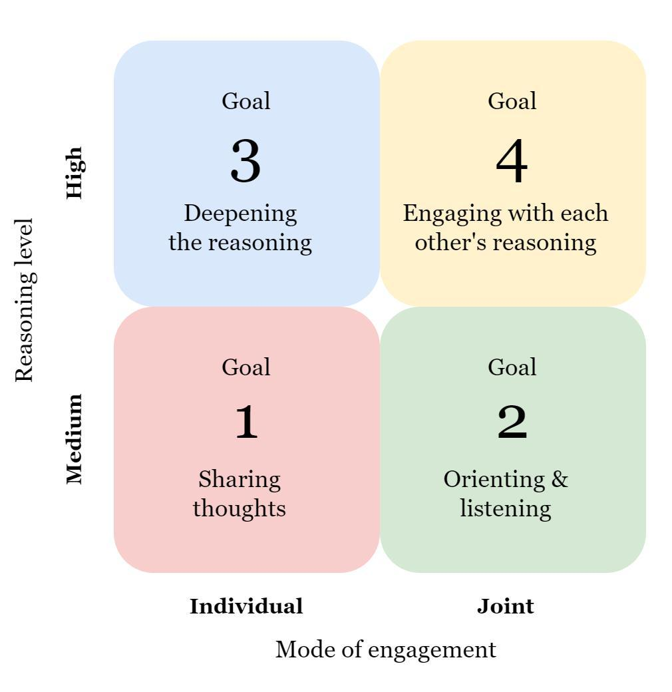

# The Four Goals for Productive Discussion

  

*The two-axis perspective of the FGPD across reasoning level and mode of engagement
(de Araujo, 2024, Figure 5.1).*

This page explains the construct that `fgpd-analyzer` measures, where it comes from, how it
was measured before, and what to keep in mind when interpreting the numbers. It draws on
Chapters 3 and 5 of de Araujo (2024).

## 1. Productive dialogue and Academically Productive Talk

Collaboration during inquiry learning can lead to higher learning outcomes, but its
efficacy depends on the students' ability to work together, a skill that must be cultivated
rather than assumed. Following Mercer (2000) and Rojas-Drummond et al. (2010), student
dialogue is considered **productive** when learners critically and constructively exchange
ideas, thereby making proposals, knowledge and reasoning visible (de Araujo, 2024, Ch. 3).

The **Academically Productive Talk** (APT) framework, also called Accountable Talk
(Michaels et al., 2008, 2016), is a widely used strategy to support this kind of dialogue.
It is content-independent: teachers (or a conversational agent) use **talk moves** that
direct students' comments and questions to each other, challenging them to reason together
and on their own. Examples are *Recapping* ("Could someone summarize what we have discussed
so far?"), *Linking contributions* ("Mike, how does that link to what Sofia just said?") and
*Example* ("Sofia, could you give us an example?"). APT has a Vygotskian basis and was
developed with the needs of scientific dialogue in mind.

Without guidance, dialogue is often not productive: verbal students dominate while others
agree superficially without adding their own thoughts (Chinn et al., 2000). Guiding several
groups at the same time is hard for a teacher, which motivates collaborative conversational
agents (CCAs) such as Clair.

## 2. The four goals

Michaels and O'Connor (2015) proposed that teacher talk is productive when it meets the
**Four Goals for Productive Discussions** (FGPD):

| Goal | Wording (Michaels & O'Connor, 2015) | In `fgpd-analyzer` |
|---|---|---|
| **G1** | "Helping individual students share their own thoughts" | `share`: students make their own task-relevant thinking public, and expand or clarify it |
| **G2** | "Helping students orient to and listen carefully to one another" | `listen`: students show, through what they write, that they attended to a peer's content |
| **G3** | "Helping students deepen their reasoning" | `deepen`: students warrant, extend or revise their own reasoning |
| **G4** | "Helping students engage with others' reasoning" | `engage`: students operate on a peer's reasoning (agree or disagree with reasons, add on, apply, challenge) |

The goals were written as goals that a *teacher* pursues. `fgpd-analyzer`, like the
studies in the thesis, measures the **student-side behaviour** each goal aims to produce,
not the talk move itself.

Why this lens: the FGPD describe **observable behaviours** and align with the learning
goals used in other CCA studies, such as explicit reasoning (Tegos et al., 2016; Weinberger
& Fischer, 2006) and transactive exchanges (Adamson et al., 2014; Noroozi et al., 2013).
They can be seen as a reinterpretation and expansion of the intended effects of CCAs on
dialogue and, because they encapsulate core tenets of APT, they can be used to assess the
productivity of dialogue on several aspects at once (de Araujo, 2024, Ch. 3).

## 3. Two axes: mode of engagement and reasoning level

Looking across the goals, Goals 1 (sharing) and 3 (deepening) are primarily **individual**
actions, while Goals 2 (orienting) and 4 (engaging) mainly involve **joint** effort. Goals 1
and 2 also seem to require much less reasoning than Goals 3 and 4. The FGPD can therefore be
read along two axes, **mode of engagement** and **reasoning level** (figure above;
de Araujo, 2024, Ch. 5):

- a contribution can be (at least partially) productive by contributing to either axis;
- this view aligns with the ICAP framework (Chi & Wylie, 2014): students need to display
  both constructive reasoning and sufficient turn-taking to benefit most from dialogue;
- Goal 4 sits at the intersection of joint mode and high reasoning. In one classroom
  trial it was the only goal that correlated significantly with knowledge acquisition
  (ρ = .414, control condition only; de Araujo, 2024, Ch. 4–5), suggesting it may be the
  most direct path to learning gains.

The thesis calls this integrative perspective **speculative**: more studies are needed on
how specific design features of CCAs affect each goal for different audiences and tasks.
Guiding students across all goals still matters, since an effect on one goal likely leads to
effects on others.

## 4. How the FGPD were measured before (ConSent + sequential pattern mining)

In the Clair studies (de Araujo, 2024, Ch. 3–4), each chat message was first coded by
**ConSent** classifiers (de Araujo et al., 2023): *focus* (domain, coordination, off-task)
and *intent* (informative, argumentative, asking for information). Each goal was then defined
as a **three-step pattern** over these codes and the speaker, searched in a **moving window
of n = 7 messages**. The outcome per goal was the count of unique pattern matches.

| Goal | Pattern (simplified from Table 3.3) |
|---|---|
| G1 | on-task informative message (any speaker) → argumentative message by the same speaker → informative or argumentative message by a different speaker |
| G2 | on-task question (any speaker) → informative or argumentative reply by a different speaker → follow-up by that same speaker |
| G3 | three domain-related informative or argumentative messages, the last two by the speaker of the first |
| G4 | domain argumentative message → argumentative message or question by a different speaker → informative or argumentative reply by the first speaker |

The rationale was that a single chat message cannot express a contribution to productivity;
a message counts only as part of a sequence that leads to a positive interaction. The window
was not required to contain adjacent messages, because chat is dynamic: typo corrections,
brief acknowledgements and shallow responses sit between meaningful contributions. Goals 1
and 2 often appear across short stretches, Goals 3 and 4 across longer ones; n = 7 was
chosen after comparing n = 5 and n = 7 as a mini-episode long enough for all goals.

## 5. Validity and interpretation (lessons from the thesis)

The General Discussion of the thesis (Ch. 5) lists considerations that apply to any FGPD
measurement and shaped the design of this package:

1. **Validity rests on the alignment between the operationalization and the APT
   description of each goal.** For pattern mining, this meant that the three-step patterns
   had to capture, for example, that G1 thoughts are "dialogical and understandable by
   others, not a monologue exhibition", and that G4 means students reasoning with others and
   responding to them.
2. **Reliability depends on the classifiers and on the segmentation parameter.** Pattern
   counts inherited ConSent's agreement with human coders (κ ≈ .60 for focus and .63 for
   intent in-domain, lower across topics and languages) and were sensitive to the window
   size: a small window misses spread-out G3/G4 patterns and underestimates them. Adamson et
   al. (2014) segmented by 5- or 2-minute intervals, which shows how hard it is to define a
   standard.
3. **Alignment with human interpretation remained an open question.** The thesis names it
   an important venue for future research.
4. **Findings require caution and contextualized interpretation.** Effects on G1, G2 and G4
   matched broader CCA research (explicit reasoning ≈ G1 + G3; transactive exchanges ≈ G4;
   idea formation ≈ G1; questioning ≈ G2; revocable assertions ≈ G4), whereas the absence of
   effects on G3 could reflect the talk-move strategy, the students' communication expertise
   or a low task difficulty. Qualitative analysis is needed to understand the mechanisms.
5. **Productivity is not learning.** Clair raised dialogue productivity (G1 in both trials of
   Ch. 3; G4 in the second; G1, G2 and G4 in Ch. 4) without a detectable effect on knowledge
   acquisition or on students' perceived productivity. Task complexity matters: without a
   task that requires collaboration, an agent may not be enough to spark it.

## 6. What `fgpd-analyzer` changes, and why

| Issue raised in the thesis | Choice in `fgpd-analyzer` |
|---|---|
| Fixed windows (n = 7) under- or over-capture goals that unfold over different stretches. | No fixed window: the whole chat is read and every **pattern** is located by its own span, segmented by idea (codebook §3). |
| A pattern either matches or not. | Each pattern gets an anchored **level 1–4** (score = level / 4); partial fulfilment counts. |
| G2 counted question→answer responsiveness; G3 counted on-topic messages of one speaker; G4 counted bare agreement. | G2 requires uptake of a peer's *content*; G3 requires warrants; G4 requires a reasoned operation on a peer's reasoning (bare agreement is level 1). |
| Reliability inherited from classifiers; alignment with humans open. | The model and human coders use the **same codebook text**, so agreement (κ) can be measured directly on identical units (`fgpd coding-sheet`). |
| Results need contextualized interpretation. | Every pattern is located in the chat (message ids, times, evidence, justification), and agent influence is separated into content uptake vs. mere temporal proximity. |

The **main metric is the raw frequency** of productive behaviours (Σ pattern scores per group
and goal). The rate per 100 student messages, the number of messages and the duration are
always reported next to it, so that "more productive talk" can be told apart from "more
talk". Groups of different sizes should not be compared directly.

## References

- Adamson, D., Dyke, G., Jang, H., & Rosé, C. P. (2014). Towards an agile approach to adapting dynamic collaboration support to student needs. *International Journal of Artificial Intelligence in Education*, 24(1), 92–124.
- Chi, M. T. H., & Wylie, R. (2014). The ICAP framework: Linking cognitive engagement to active learning outcomes. *Educational Psychologist*, 49(4), 219–243. https://doi.org/10.1080/00461520.2014.965823
- de Araujo, A. (2024). *Could you elaborate more on what your partner just said? Guiding dialogue in science education using a conversational agent* [Doctoral dissertation, University of Twente]. https://doi.org/10.3990/1.9789036563154
- de Araujo, A., Papadopoulos, P. M., McKenney, S., & de Jong, T. (2023). Automated coding of student chats, a trans-topic and language approach. *Computers and Education: Artificial Intelligence*, 4, 100123. https://doi.org/10.1016/j.caeai.2023.100123
- de Araujo, A., Papadopoulos, P. M., McKenney, S., & de Jong, T. (2024). A learning analytics-based collaborative conversational agent to foster productive dialogue in inquiry learning. *Journal of Computer Assisted Learning*. https://doi.org/10.1111/jcal.13007
- Michaels, S., & O'Connor, C. (2015). Conceptualizing talk moves as tools: Professional development approaches for academically productive discussions. In L. B. Resnick, C. Asterhan, & S. N. Clarke (Eds.), *Socializing intelligence through academic talk and dialogue* (pp. 333–347). American Educational Research Association.
- Michaels, S., O'Connor, C., & Resnick, L. B. (2008). Deliberative discourse idealized and realized: Accountable talk in the classroom and in civic life. *Studies in Philosophy and Education*, 27(4), 283–297. https://doi.org/10.1007/s11217-007-9071-1
- Michaels, S., O'Connor, M. C., Hall, M. W., & Resnick, L. B. (2016). *Accountable Talk: Classroom conversation that works*. University of Pittsburgh.
- Tegos, S., Demetriadis, S., Papadopoulos, P. M., & Weinberger, A. (2016). Conversational agents for academically productive talk: A comparison of directed and undirected agent interventions. *International Journal of Computer-Supported Collaborative Learning*, 11(4), 417–440. https://doi.org/10.1007/s11412-016-9246-2
- Weinberger, A., & Fischer, F. (2006). A framework to analyze argumentative knowledge construction in computer-supported collaborative learning. *Computers & Education*, 46(1), 71–95. https://doi.org/10.1016/j.compedu.2005.04.003

Other works cited here (Chinn et al., 2000; Mercer, 2000; Noroozi et al., 2013; Rojas-Drummond et al., 2010) are listed in the references of de Araujo (2024).
